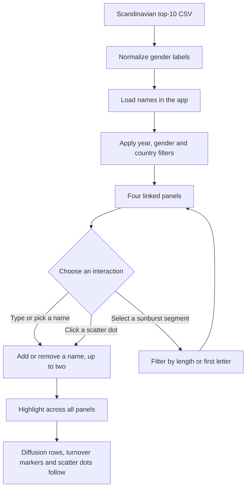

# Book of Names: Top 10 Scandinavian Baby Names

An information visualization project for exploring popular baby names in Denmark, Norway, and Sweden from 2000 to 2022. The dataset contains top-10 records sourced from SSB, Statistics Denmark, and SCB.

## Run locally

The frontend uses plain HTML, CSS, and JavaScript with a local copy of D3.js 7.9.0.
No Node.js, npm, framework, transpiler, or build step is needed.

### Live Server

Open this folder in VS Code with Live Server installed, then right-click
`index.html` and choose **Open with Live Server**.

### Python alternative

From this folder, run:

```sh
python3 -m http.server 8000 --bind 127.0.0.1
```

Open `http://127.0.0.1:8000/`. Stop the server with Ctrl+C.
Use HTTP rather than opening the HTML via `file://`, because JavaScript modules
and CSV loading need a local server.

### Offline use and submission

D3 is included in `src/vendor/d3.v7.9.0.min.js`, with its original license in
`src/vendor/D3-LICENSE.txt`. `src/d3.js` makes it available to the native JavaScript
modules. No CDN or runtime downloads are used.

Include `index.html`, `src/`, and `public/` together in the submission, including
the D3 license and CSV dataset. With the local server running, the prototype can
be reloaded and used without an internet connection.

## Using the visualization

The dashboard is four linked panels sharing one set of filters. Up to two names can
be selected at once, and selecting a name in any panel updates all of them.

Colours stay the same across the dashboard: Sweden is blue, Norway red and Denmark
green, and girls' names are pink and boys' names blue in the filters, the name chips,
the names list and the diffusion labels.

### Filters

- **Name search** — type to highlight matching names, or pick one from the suggestions
  to add it. Selected names appear as chips in the search box; click a chip's × (or
  press Backspace in the empty box) to remove it. Up to two names at a time.
- **Year interval** — the two-handle slider sets the period every panel reports on.
- **Gender** and **Country** — narrow the dataset; `All` is the default for both.
- **Reset all** — clears the selection and returns the year, gender and country filters
  to their defaults.

### Panels

- **Naming turnover** — the share of each year's top 10 that was not there the year
  before, one line per country. Starts at 2001, since 2000 has no previous year to
  compare against. With a name selected, a dot marks each year it joined or left a
  country's top 10, placed at that year's churn level.
- **Name characteristics** — a sunburst of the available names, grouped by name length
  (inner ring) then first letter (outer ring). Select a segment to narrow the names
  list; the chosen group expands outward and reveals its letters. The segments of
  every selected name stay highlighted. Click a name in the list to add it, click it
  again to remove it. Click the middle to clear the sunburst's own selection.
- **Cross-country diffusion** — for each selected name, the years it held a place in
  each country's top 10, with its peak rank marked. With several names, each country
  row splits into one bar per name, labelled on the right.
- **Peak against longevity** — one dot per name and country, plotting the best rank a
  name reached against how many years it spent in the top 10. Every selected name is
  highlighted in each country. Scroll to zoom, drag to pan, double-click to reset.
  Click a dot to add or remove that name. The Density view groups the dots into cells.

The two left-hand panels share an x-axis scale, so a given year sits at the same
position in both and they can be read together.

The CSV dataset is located at `public/scandinavia_top10_babynames_2000_2022.csv` and is loaded by the app at runtime.

## A note on the data

The source lists are top 10 per country, per sex, per year, so with `Gender: All` each
country contributes 20 names a year. A handful of Swedish years have 21, because SCB
reports ties at rank 10 rather than breaking them.

Lifecycle figures are bounded by the selected period: a name already listed when the
period opens, or still listed when it closes, has no observable entry or exit, so its
rise and longevity are minimums rather than exact values.

## Project flow


